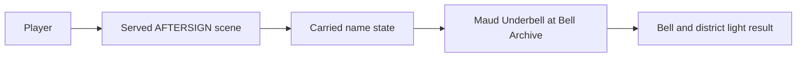
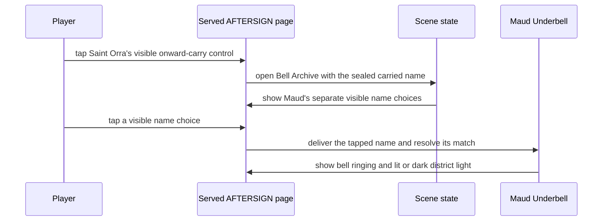

# Design — #2598 Bell Archive name delivery

**Story:** #2598 · **Spec:** [docs/specs/2598-bell-archive-name.md](../specs/2598-bell-archive-name.md) · **Architecture:** [docs/plan/architecture/README.md](../plan/architecture/README.md)

## Components

The served AFTERSIGN scene owns the visible delivery interaction. The courier's carried name determines the archive result; Maud Underbell presents that result in the Bell Archive.

## Flow

## Data

The scene reads the name the courier carries from the preceding episode state and records whether the resulting district light is lit or dark. The build implementation defines persistence; this design does not introduce a save format.

## Test map

| AC | Test file | Test name | Fails on main because |
|---|---|---|---|
| AC-1 | `apps/web/e2e/aftersign/bell-archive-name.spec.ts` | `onward carry opens Maud's separate name choices` | Maud and the delivery interaction are absent from the served page. |
| AC-2 | `apps/web/e2e/aftersign/bell-archive-name.spec.ts` | `matching name rings the bell and keeps the district light lit` | The served page has no Bell Archive outcome. |
| AC-3 | `apps/web/e2e/aftersign/bell-archive-name.spec.ts` | `different name rings the bell and darkens one district light` | The served page has no Bell Archive outcome. |
| AC-4 | `apps/web/e2e/aftersign/bell-archive-name.spec.ts` | `bell outcome saves before browser storage is cleared` | No Bell Archive outcome is saved through the game's save service. |
| AC-5 | `apps/web/e2e/aftersign/bell-archive-name.spec.ts` | `saved Bell Archive outcome restores in a fresh browser context` | No saved Bell Archive ending card can be restored. |
| AC-6 | `apps/web/e2e/aftersign/bell-archive-name.spec.ts` | `Bell Archive text names only the tapped handoff and choice` | No delivery outcome is rendered. |

## Risks

- The visible delivery control must be reachable by a player tap at the phone viewport; tests must use that control rather than a harness input.
- The rendered result must not claim a name or choice the player did not carry.
