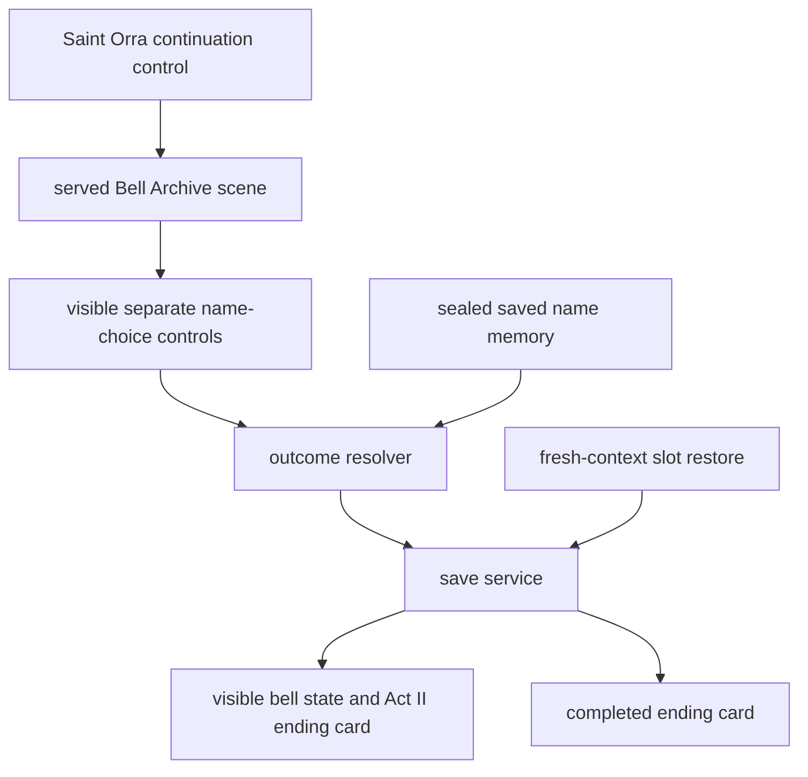
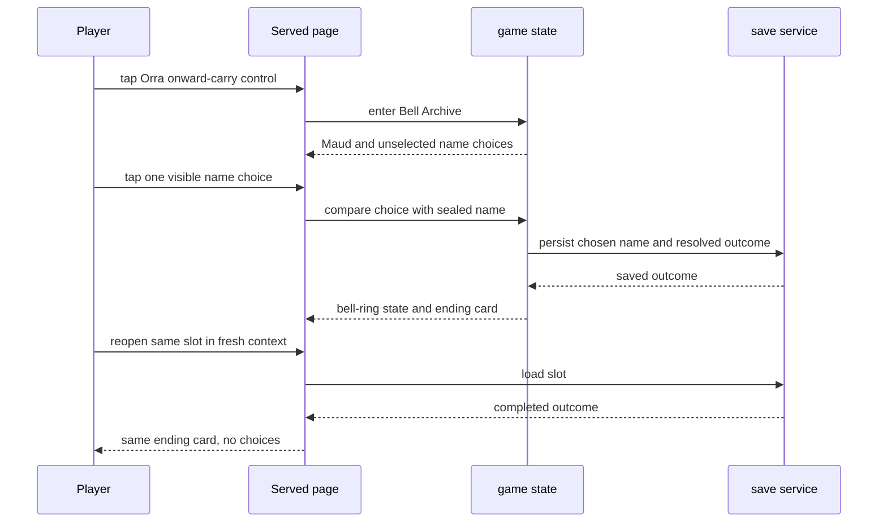

# Design — #2598 Bell Archive name delivery

**Story:** #2598 · **Epic:** #2579 · **Spec:** [docs/specs/2598-bell-archive-name.md](../specs/2598-bell-archive-name.md) · **Architecture:** [docs/plan/architecture/README.md](../plan/architecture/README.md)

## Intent

Extend the served Episode 1 continuation with one tap-reachable Bell Archive scene. The scene derives the correct visible name from the sealed saved memory, persists the player's selected outcome before the result is shown as complete, and restores that completed result instead of presenting choices again.

## Component diagram

## Interaction and persistence

- The existing post-Episode-1 Saint Orra continuation control enters the Bell Archive scene at the 390×844 served layout.
- The scene renders Maud and two simultaneously visible, separately tappable name choices with neither choice selected initially.
- The resolver compares the tapped choice with the sealed stored name. A match produces the lit district result; a non-match produces the dark district result.
- Before considering the outcome complete, the client writes the selected name and resolved district-light outcome through the existing save service.
- A restored completed outcome renders the bell and its stored ending card, not the choices. Narrative strings are selected from the recorded tap path only.

## Sequence

## Test map

| Acceptance criterion | Served E2E assertion |
|---|---|
| AC-1 | At 390×844, tap the visible Orra onward-carry control and assert Maud plus two visible separate choices. |
| AC-2 | Seed/drive the matching stored name, tap its visible choice, and assert a visible bell state and “stays lit” ending. |
| AC-3 | Drive the other visible choice and assert a visible bell state and “goes out” ending. |
| AC-4 | Await the save write containing the resolved outcome before clearing browser storage. |
| AC-5 | In a fresh browser context for the same slot after storage clear, assert the same ending card and absent choice surface. |
| AC-6 | Drive each path by taps and assert displayed Io, Orra, and Maud lines only describe its recorded controls. |

## Failure handling

A failed save does not create a completed Bell Archive result: keep the choice interaction recoverable and do not treat a client-only outcome as restored progress. The bell's visual state and ending text remain authoritative without relying on audio.

## Constitution check

- C1: pass — this is an AFTERSIGN flagship story.
- C2: pass — all player transitions and both outcomes are driven through visible taps at 390×844.
- C3: pass — the test map assigns a served E2E assertion to every AC before implementation.
- C4: pass — implementation is consumed by the served continuation, not a harness-only interface.
- C5: pass — stored tap-path data, rather than inferred actions, selects narrative text.
- C6: pass — this design follows the linked research and spec and supplies the required diagrams and test map.
- C7: pass — CI can verify the served interaction and fresh-context restoration.
- C8: pass — work ends at the Bell Archive outcome and one ending card.
