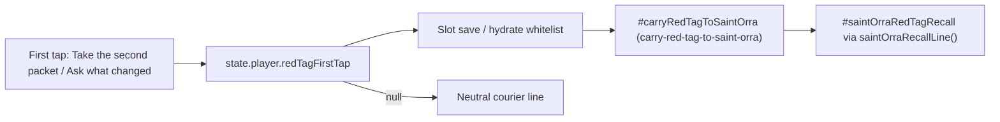
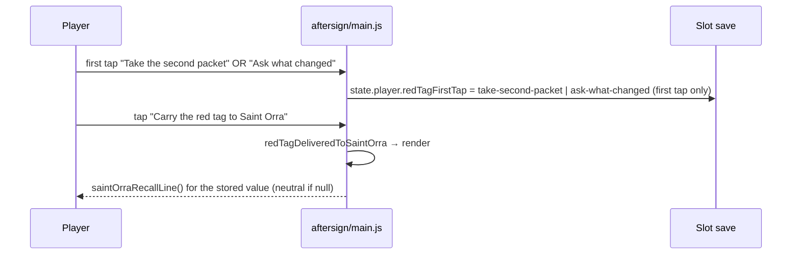

# Design — #2724 Red tag continuity at Saint Orra

**Delivery issue:** #2741 · **Story:** #2724 · **Spec:** [docs/specs/2724-red-tag-saint-orra.md](../specs/2724-red-tag-saint-orra.md) · **Architecture:** [docs/plan/architecture/README.md](../plan/architecture/README.md)

This design describes the **shipped** flow on main and the one remaining gap. It adds no new state, control or copy.

## Components (shipped)

## Flow (shipped)

## Data (shipped)

| What | Where on main |
|---|---|
| `state.player.redTagFirstTap: "take-second-packet" \| "ask-what-changed" \| null`, initial `null` | `aftersign/main.js:5576` |
| Written on the first tap only | `aftersign/main.js:4462-4463` |
| Restored from the slot; only the two values are accepted | `aftersign/main.js:1230-1233` |
| Carry control `#carryRedTagToSaintOrra`, `data-choice-id="carry-red-tag-to-saint-orra"` | `aftersign/main.js:2563-2572` |
| Recall `#saintOrraRedTagRecall` | `aftersign/main.js:2542-2555` |
| `saintOrraRecallLine()`: took-at-once line, asked-first line, neutral courier line | `aftersign/main.js:2511-2520` |

Orra's line is picked from `redTagFirstTap` alone. The job offer, the delivery id and the packet-outcome memory never choose it.

## Test map

Every test taps the served page at a 390×844 viewport. No test sets `state` directly.

| AC | Status | Covered by |
|---|---|---|
| AC-1 carry control | Shipped, passing on main | `aftersign/e2e/episode-one-ending-served.spec.ts:322-364`; `aftersign/e2e/m4-act-two.playtest.spec.ts:118-153` |
| AC-2 took-at-once line | Shipped, passing on main | same as AC-1 |
| AC-3 asked-first line | Shipped, passing on main | same as AC-1 |
| AC-4 reload keeps the tap | Shipped, passing on main (fresh-context reload) | `episode-one-ending-served.spec.ts:322-364` |
| AC-5 neutral fallback | **Gap.** The code branch exists (`main.js:2519`), but the cited specs assert only the two tapped branches. | New case in `episode-one-ending-served.spec.ts`. Reach the ending without a first tap, through the existing visible reset path. Carry the tag. Assert "You brought the red tag to my door. I remember the courier." Assert that the recall contains neither "at once" nor "asked what changed". |

No row claims that a test fails on main. AC-1 to AC-4 already pass. AC-5 is a new coverage check on code that has already shipped, so it should pass on main as soon as it is written. Its value is regression protection.

## Open question

- Can the player reach Saint Orra on the served page with `redTagFirstTap === null`? If the first-tap choice is mandatory before the ending, the neutral branch can only be hit through a legacy slot that lacks the field (hydrate keeps it `null`, `main.js:1230-1233`). In that case AC-5 must be driven by loading such a slot through the visible slot UI, not by setting `state`.

## Risks

- Adding a second field or enum (for example under `state.memory`) would fork the source of truth. Reuse `state.player.redTagFirstTap`.
- A parallel spec file would duplicate the existing red-tag cases. Extend `episode-one-ending-served.spec.ts` instead.
