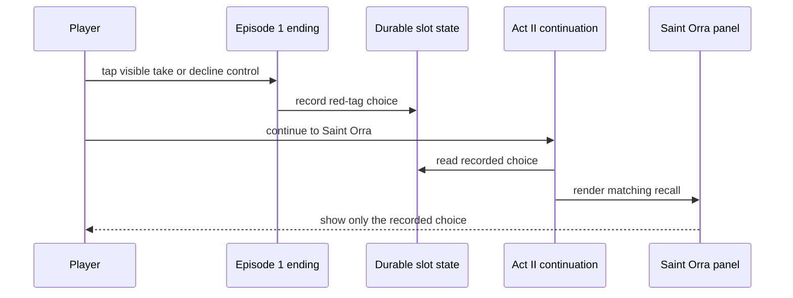

# Design — #2724 Red tag continuity at Saint Orra

**Delivery issue:** #2741 · **Story:** #2724 · **Spec:** [docs/specs/2724-red-tag-saint-orra.md](../specs/2724-red-tag-saint-orra.md) · **Architecture:** [docs/plan/architecture/README.md](../plan/architecture/README.md)

## Components

The Episode 1 ending records the red-tag result. Durable slot state retains that result, and the Act II continuation supplies it to Saint Orra's visible recall.

## Flow

## Data

The red-tag choice is written at the Episode 1 ending and persisted with the player's slot. The Act II continuation reads that same durable value after reload; it does not infer a choice from other ending facts.

## Test map

| AC | Test file | Test name | Fails on main because |
|---|---|---|---|
| AC-1 | `aftersign/e2e/red-tag-saint-orra.spec.ts` | `carries a taken red tag to Saint Orra` | The take path lacks verified continuity to Orra. |
| AC-2 | `aftersign/e2e/red-tag-saint-orra.spec.ts` | `carries a declined red tag to Saint Orra` | The decline path lacks verified continuity to Orra. |
| AC-3 | `aftersign/e2e/red-tag-saint-orra.spec.ts` | `Saint Orra recalls only the chosen red-tag action` | Orra's recall lacks verified branch-specific coverage. |
| AC-4 | `aftersign/e2e/red-tag-saint-orra.spec.ts` | `preserves red-tag choice after reload before Saint Orra` | Reload persistence lacks verified coverage. |

## Risks

- Inferring the red-tag result from a related ending flag could make Saint Orra state a false memory.
- A test that mutates game state rather than tapping the visible Episode 1 control would not verify the player flow.
