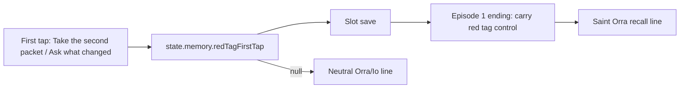
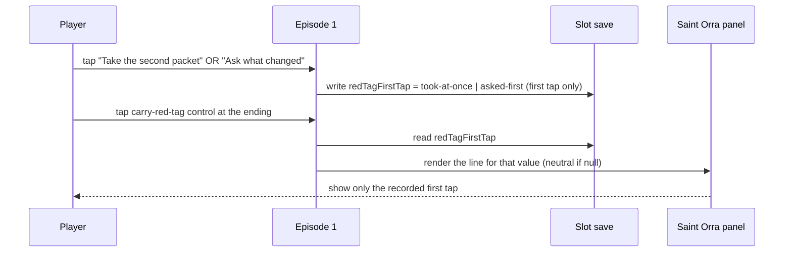

# Design — #2724 Red tag continuity at Saint Orra

**Delivery issue:** #2741 · **Story:** #2724 · **Spec:** [docs/specs/2724-red-tag-saint-orra.md](../specs/2724-red-tag-saint-orra.md) · **Architecture:** [docs/plan/architecture/README.md](../plan/architecture/README.md)

## Components

The first tap ("Take the second packet" or "Ask what changed") writes `state.memory.redTagFirstTap`. The slot save keeps that value. The new "carry the red tag to Saint Orra" control at the Episode 1 ending leads to Saint Orra. Saint Orra's recall then reads `redTagFirstTap`, and nothing else, to pick her line.

## Flow

## Data

- New field: `state.memory.redTagFirstTap: "took-at-once" | "asked-first" | null`. It starts as `null`.
- Only the first tap writes it. Later taps leave it unchanged.
- It is saved with the slot, so a reload restores it.
- Saint Orra's line is chosen from this field alone. The red-tag job offer, the delivery id, and packet-outcome memory never decide which line plays.
- New copy, defined in this story with exact text:
  - `ORRA_RED_TAG_TOOK_AT_ONCE`: Orra says the player took the red tag at once.
  - `ORRA_RED_TAG_ASKED_FIRST`: Orra says the player asked what changed first.
  - `ORRA_RED_TAG_NEUTRAL`: claims neither.
  - The new carry control label.

## Test map

Every test taps the served page at a 390×844 viewport. No test sets `state` directly.

| AC | Test file | Test name | Fails on main because |
|---|---|---|---|
| AC-1 | `aftersign/e2e/red-tag-saint-orra.spec.ts` | `shows a carry-red-tag-to-Saint-Orra control at the Episode 1 ending` | The test asserts the new carry control by its label. That control does not exist on main, so the locator finds nothing. |
| AC-2 | `aftersign/e2e/red-tag-saint-orra.spec.ts` | `Orra recalls the red tag was taken at once after tapping Take the second packet` | The test asserts the exact `ORRA_RED_TAG_TOOK_AT_ONCE` text in the Saint Orra panel. That copy is new in this story, so it is absent on main. |
| AC-3 | `aftersign/e2e/red-tag-saint-orra.spec.ts` | `Orra recalls the player asked first after tapping Ask what changed` | The test asserts the exact `ORRA_RED_TAG_ASKED_FIRST` text. That copy is new, so it is absent on main. |
| AC-4 | `aftersign/e2e/red-tag-saint-orra.spec.ts` | `never claims took-at-once unless Take the second packet was tapped` | On the Ask-first path, the test asserts that `ORRA_RED_TAG_ASKED_FIRST` is visible and that no Orra or Io line contains `ORRA_RED_TAG_TOOK_AT_ONCE`. The positive check fails on main, so the test cannot pass there by default. |
| AC-5 | `aftersign/e2e/red-tag-saint-orra.spec.ts` | `keeps the recorded first tap across a reload before Saint Orra` | The test taps, reloads, carries the tag to Orra, then asserts the matching new line. `redTagFirstTap` and that line do not exist on main. |

## Risks

- Picking Orra's line from the delivery id or the red-tag job offer would give the player a false memory. Only `redTagFirstTap` decides it.
- A test that sets state directly, or calls `window.__game` helpers, instead of tapping visible controls would not verify the player flow. Such a test does not satisfy the spec.
