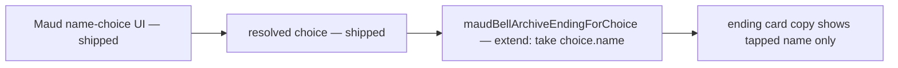
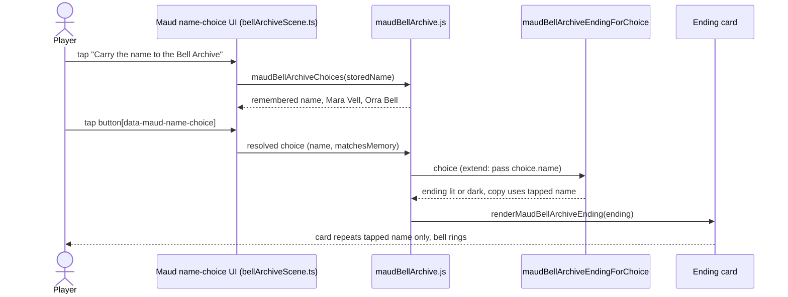

# Design — #2725 Bell Archive name choice

**Story:** #2725 · **Spec:** [docs/specs/2725-bell-archive-name-choice.md](../specs/2725-bell-archive-name-choice.md) · **Architecture:** [docs/plan/architecture/README.md](../plan/architecture/README.md)

## What already ships on main

The Maud / Bell Archive flow is already built. This story does not rebuild it.

- `aftersign/src/maudBellArchive.js` builds the choices. `maudBellArchiveChoices(storedName)` returns the remembered name plus the decoys `Mara Vell` and `Orra Bell`. `renderMaudBellArchive` hands the choice UI to `renderBellArchiveScene` in `aftersign/src/bellArchiveScene.ts`.
- `maudBellArchiveEndingForChoice` picks one of two endings:
  - `maud-bell-archive-lit`: "The district light stays lit."
  - `maud-bell-archive-dark`: "One district light goes out."
- `renderMaudBellArchiveEnding` renders the ending card and rings the bell.
- `aftersign/e2e/m4-act-two.playtest.spec.ts:162-186` is the existing tap-driven test. It taps `Carry the name to the Bell Archive`, then taps `button[data-maud-name-choice=…]`. It checks that the ending card is visible and restores in a fresh context.

## The gap this story closes (AC-4)

The ending `line` and `dialogue` strings in `maudBellArchiveEndingForChoice` are fixed text. They never show the name the player tapped. AC-4 needs Maud's dialogue and the ending card to repeat the tapped name and no other displayed name.

## Data

- The comparison source is still Orra's stored name, unchanged.
- The ending builder gets the tapped choice's `name` along with `matchesMemory`. Its copy uses that name.
- An ending restored from `endingId` alone has no tapped name to show. It must use the neutral copy and must not insert a decoy.
- Persistence changes are out of scope.

## Test map

| AC | Test file | Test name | Status on main |
|---|---|---|---|
| AC-1 | `aftersign/e2e/m4-act-two.playtest.spec.ts` (existing, :162-173) | existing red-tag → Maud scenario | Already covered and passing. No new test. |
| AC-2 | `aftersign/e2e/m4-act-two.playtest.spec.ts` (existing, :175-186) | existing scenario, matching choice → `maud-bell-archive-lit` | Already covered and passing. No new test. |
| AC-3 | `aftersign/e2e/m4-act-two.playtest.spec.ts` (existing, :175-186) | existing scenario, decoy choice → `maud-bell-archive-dark` | Already covered and passing. No new test. |
| AC-4 | Proposed: extend `aftersign/e2e/m4-act-two.playtest.spec.ts` | `ending copy names only the tapped name` | Fails on main: the ending card copy is fixed text and never contains the tapped name. |

The AC-4 test reuses the existing tap path. After the tap, it checks that the ending card contains the tapped name. It also checks that the card contains neither of the other two displayed names. That covers the remembered name, `Mara Vell` and `Orra Bell`.

## Risks

- A harness hook that sets state directly would skip the player-visible route. The AC-4 assertion must come after real taps.
- Decoy `Orra Bell` contains `Orra`, and fixed copy already says "Orra hears…". The "no other name" check must match the full decoy string, not the substring `Orra`.
