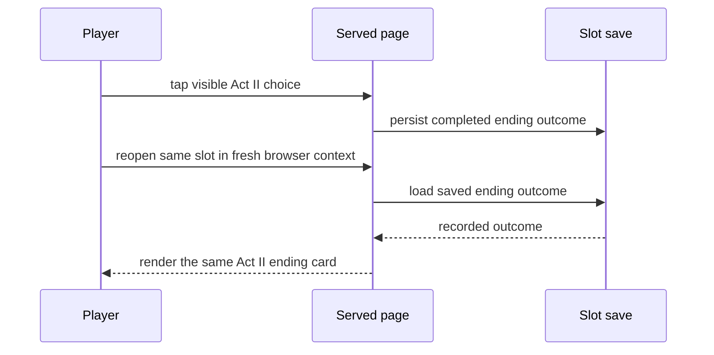

# Design — #2726 Durable Act II ending

**Story:** #2726 · **Spec:** [docs/specs/2726-durable-act-ii-ending.md](../specs/2726-durable-act-ii-ending.md) · **Architecture:** [docs/plan/architecture/README.md](../plan/architecture/README.md)

## Components

The served AFTERSIGN page records the completed Act II ending in the slot save. On a later open, the save loader supplies that recorded outcome to the ending renderer.

## Flow

## Data

The slot save owns the completed Act II ending outcome (lit or dimmed) and the name shown with it. Both are written when the player completes the ending and read when the same slot opens; it survives a fresh browser context because the authoritative slot save, rather than retained browser storage, supplies it.

## Test map

| AC | Test file | Test name | Fails on main because |
|---|---|---|---|
| AC-1 | `aftersign/e2e/durable-act-ii-ending.spec.ts` | `restores the same Act II ending outcome and name in a fresh browser context` | After reopening the same slot in a new context, the test asserts the visible ending card's outcome (lit/dimmed) and the visible name both equal the values captured before closing; on main the authoritative slot save does not restore them. |
| AC-2 | `aftersign/e2e/durable-act-ii-ending.spec.ts` | `reaches the lit ending by taps only at 390×844` | Runs under the `main-e2e` job with viewport 390×844 and `hasTouch`, using only `tap()` on visible controls (no `click`, keyboard, or `window.__game` writes), and asserts the lit ending card is shown. |
| AC-2 | `aftersign/e2e/durable-act-ii-ending.spec.ts` | `reaches the dimmed ending by taps only at 390×844` | Same constraints as the lit case; asserts the dimmed ending card is shown. Both cases then reopen the slot in a fresh context and re-assert AC-1's outcome and name. |
| AC-3 | `aftersign/e2e/durable-act-ii-ending.spec.ts` | `does not reopen an Act II choice after restoring an ending` | The restored-ending view can still expose a choice that replaces the saved ending or name. |

## Risks

- Client-retained storage can mask a missing authoritative save restore; the fresh-context test must use visible controls to complete the ending and use `window.__game` only to assert state.
- A mismatched slot identity could restore another player's outcome, so the test must reopen the exact same slot.
