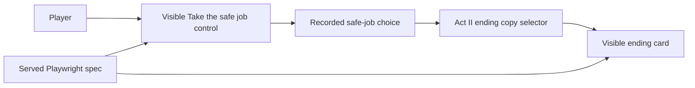
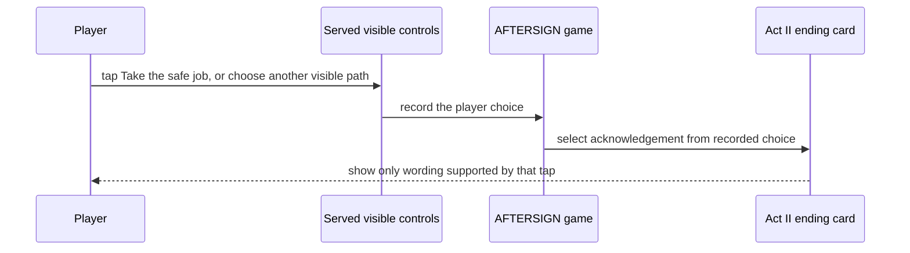

# Design — #2846 Safe-route trust acknowledgement

**Story:** #2846 · **Spec:** [docs/specs/2846-safe-route-trust.md](../specs/2846-safe-route-trust.md) · **Architecture:** [docs/plan/architecture/README.md#episode-1-from-choices-to-the-ending](../plan/architecture/README.md#episode-1-from-choices-to-the-ending)

## Components

The visible safe-job control records whether the player accepted the job. The Act II ending selects acknowledgement copy from that recorded fact; the served spec taps the rendered controls and reads the ending only for assertions.

## Flow

## Data

The build reads the existing recorded safe-job choice that distinguishes tapping **Take the safe job** from not tapping it. The decision is passed to the Act II ending-copy selection; it must not infer acceptance from the Lit stair route or other route facts. Persistence mechanics and save schema changes are out of scope for this story.

## Test map

| AC | Test file | Test name | Fails on main because |
|---|---|---|---|
| AC-1 | `aftersign/e2e/safe-route-trust.spec.ts` | `acknowledges taking the safe job at the Act II ending` | The served ending does not yet distinguish the recorded visible safe-job acceptance from the Lit stair route. |
| AC-2 | `aftersign/e2e/safe-route-trust.spec.ts` | `does not credit the safe job when it was not tapped` | A Lit stair path that never taps **Take the safe job** can receive the safe-route trust wording. |
| AC-3 | `aftersign/e2e/safe-route-trust.spec.ts` | `reaches both safe-job acknowledgement outcomes by visible pointer taps at 390×844` | The coverage must prove both paths through rendered controls rather than harness input. |

## Risks

- Route choice is not safe-job acceptance; treating the Lit stair as acceptance would violate C5.
- A test that mutates `window.__game` would not prove the player can reach either outcome; it is assertion-only.
