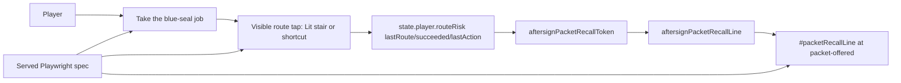
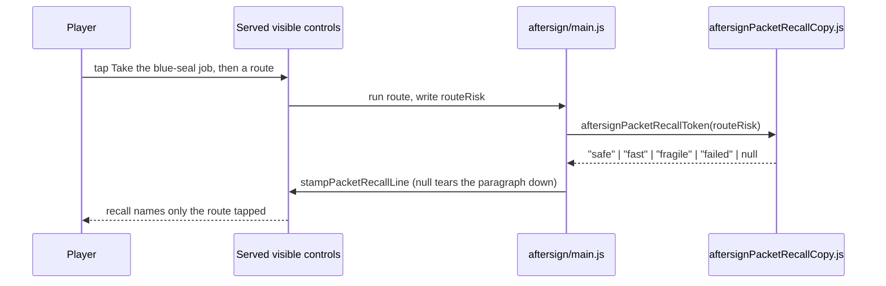

# Design — #2846 Safe-route trust acknowledgement

**Story:** #2846 · **Spec:** [docs/specs/2846-safe-route-trust.md](../specs/2846-safe-route-trust.md) · **Architecture:** [docs/plan/architecture/README.md#episode-1-from-choices-to-the-ending](../plan/architecture/README.md#episode-1-from-choices-to-the-ending)

## Components

No new control and no new recorded fact. The player takes the job with the existing **Take the blue-seal job** control. They then tap a visible route: **Lit stair — under Io's window** or the shortcut. `aftersign/main.js` records the run as `state.player.routeRisk = { ...recordRouteRun({ route, succeeded }), lastAction: action }`. At the `packet-offered` beat, `aftersignPacketRecallToken(routeRisk)` picks a token. `aftersignPacketRecallLine(token)` returns the playtest-6 copy, and `stampPacketRecallLine` renders `#packetRecallLine`. A `null` token removes the paragraph. The served spec taps the rendered controls and reads the game state only for assertions.

## Flow

## Data

The design reads only the existing `state.player.routeRisk` fact, `{ lastRoute, succeeded, lastAction }`. `aftersign/main.js` writes it when a route runs. A Lit stair run is `lastRoute: "safe"` and resolves to the `safe` token. The shortcut resolves to `fast` and the fragile carry to `fragile`. An absent `routeRisk` resolves to `null`, so no recall is shown. No "safe-job" fact exists in the code, and this story adds none. There is no save schema change.

## Test map

| AC | Test file | Test name | Fails on main because |
|---|---|---|---|
| AC-1 | `aftersign/e2e/safe-route-trust.spec.ts` (new) | `lit stair recall names the lit stair, never the safe route` | No served spec asserts the playtest-6 line on `#packetRecallLine` after real taps. Only the unit pin in `aftersignPacketRecallSafeCopy.test.ts` covers it. |
| AC-2 | `aftersign/e2e/safe-route-trust.spec.ts` (new) | `shortcut recall never borrows the lit stair line` | No served spec checks that the shortcut run's recall avoids lit-stair or safe-route wording. |
| AC-3 | `apps/web/src/aftersign/aftersignPacketRecallSafeCopy.test.ts` | `absent route memory renders no recall` (new case) | No case in that file asserts that `aftersignPacketRecallToken(undefined)` gives `null` and `aftersignPacketRecallLine(null)` gives `""`. |
| AC-4 | `aftersign/e2e/safe-route-trust.spec.ts` (new) | `reaches both recall outcomes by visible pointer taps at 390×844` | No served journey proves both outcomes through rendered controls. |

The existing guard `expect(line).not.toMatch(/worth trusting again/i)` in `aftersignPacketRecallSafeCopy.test.ts` stays as it is.

## Risks

- A route choice is not a job choice. The recall must not grow wording about "taking the safe job", because no such control or fact exists (C5).
- A test that writes to `window.__game` would not prove the player can reach either outcome. The served spec is assertion-only.
