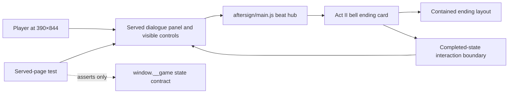
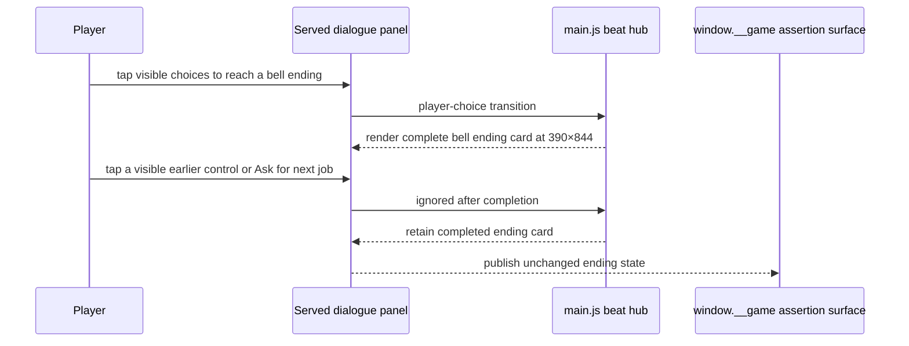

# Design — #2847 Act II bell ending containment

**Story:** #2847 · **Spec:** [docs/specs/2847-act-ii-bell-ending-containment.md](../specs/2847-act-ii-bell-ending-containment.md) · **Architecture:** [docs/plan/architecture/README.md#episode-1-from-choices-to-the-ending](../plan/architecture/README.md#episode-1-from-choices-to-the-ending)

## Components

`aftersign/main.js` owns the Act II beat and completed-ending state. Its ending-card layout must fit the complete authored text in the target phone viewport. The served dialogue panel and controls expose earlier-stage controls; upon completion, their visible interaction boundary must not dispatch a transition that changes the ending. The test surface asserts resulting beat and ending state only.

## Flow

## Data

The implementation reads the existing beat and ending state and does not introduce a save field. The completed ending remains the existing durable ending outcome; containment prevents stale visible controls from replacing it.

## Test map

| AC | Test file | Test name | Fails on main because |
|---|---|---|---|
| AC-1 | `aftersign/tests/act-ii-bell-ending-containment.spec.ts` | `shows each Act II bell ending through its final line at 390x844 without a swipe` | the ending layout can place its final line below the target viewport. |
| AC-2 | `aftersign/tests/act-ii-bell-ending-containment.spec.ts` | `keeps a completed bell ending after visible stale-control and Ask for next job taps` | earlier-stage handlers can still transition away from completion. |

## Risks

- A layout-only assertion can miss a hidden final line; the served-page test must establish the 390×844 viewport and inspect the rendered final line without scrolling.
- Controls may remain reachable in the DOM after completion; the test must use pointer taps on any still-visible earlier control and **Ask for next job**, then assert the ending is unchanged rather than mutating state through a harness hook.
