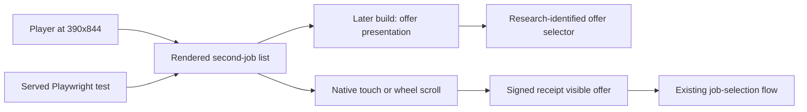
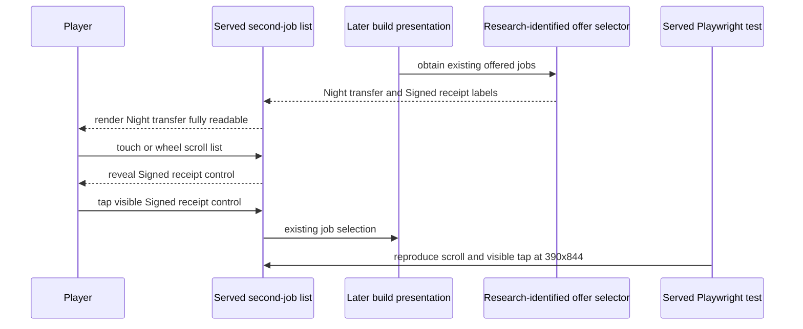

# Design — #2848 Phone scrolling for the second job list

**Story:** #2848 · **Spec:** [docs/specs/2848-second-job-list-phone-scroll.md](../specs/2848-second-job-list-phone-scroll.md) · **Architecture:** [docs/plan/architecture/README.md#client-components](../plan/architecture/README.md#client-components)

## Components

Research identifies `packages/aftersign/src/computeOfferedJobs.ts` as the current source of the “Night transfer” and “Signed receipt” labels. The later build must identify and adjust the served second-job-list presentation so its visible offer controls occupy a bounded, natively scrollable region at phone height. The proposed served Playwright test will reach that list through visible controls, scroll its rendered container, and tap the revealed offer; no such test is added by this documentation-only change.

## Flow

## Data

The build reads the existing offered-job list and uses the existing selected-job flow. It introduces no save fields and does not modify the selector’s player-history rules, labels, or durable state.

## Test map

These are proposed build-stage tests. `aftersign/e2e/second-job-list-phone-scroll.spec.ts` does not exist in this documentation-only change and no served Playwright test is added here.

| AC | Proposed test file | Proposed test name | Must fail on main because |
|---|---|---|---|
| AC-1 | `aftersign/e2e/second-job-list-phone-scroll.spec.ts` | `shows the complete Night transfer offer at 390x844` | The second-job list can clip the “Night transfer” offer at phone height. |
| AC-2 | `aftersign/e2e/second-job-list-phone-scroll.spec.ts` | `reveals Signed receipt by scrolling the rendered list at 390x844` | The lower offer is clipped and has no proved player-operated scroll path. |
| AC-3 | `aftersign/e2e/second-job-list-phone-scroll.spec.ts` | `selects Signed receipt by tapping its visible control after scrolling` | The served flow has no proved visible-control selection after scroll. |

## Risks

- The build must preserve native scrolling rather than hiding overflow affordance or invoking a harness input hook.
- The monolithic `aftersign/main.js` can change state without reaching the served page; the build test must use the rendered list and offer control, with `window.__game` only for assertions.
- The scroll-region height must leave “Night transfer” fully readable while allowing “Signed receipt” to become reachable.
