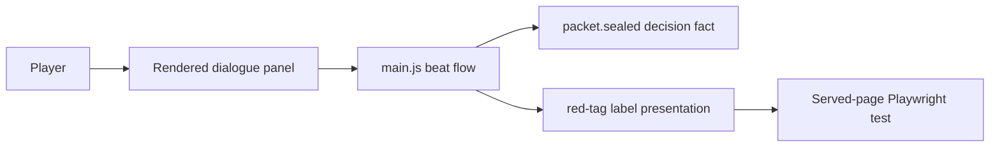
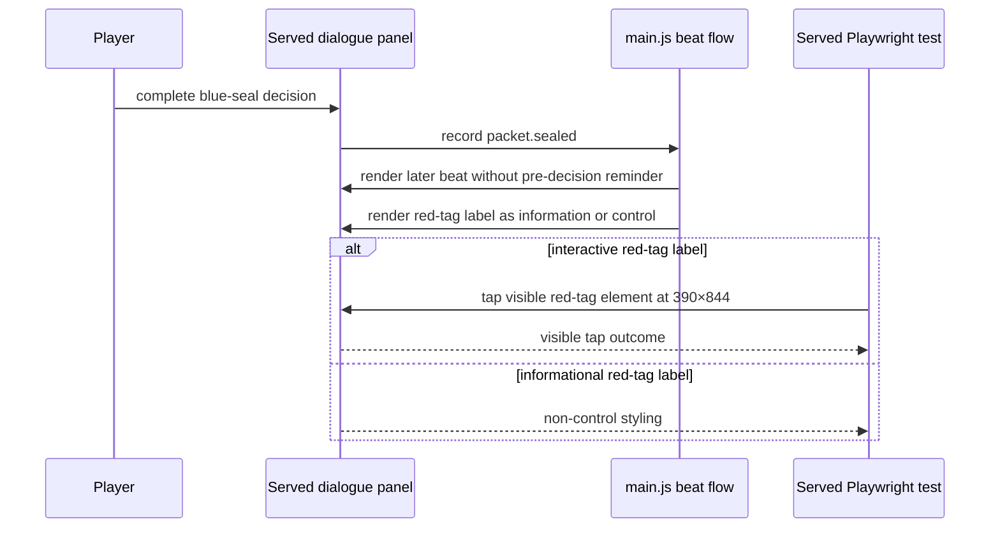

# Design — #2849 Stale seal prompt and red-tag affordance

**Story:** #2849 · **Spec:** [docs/specs/2849-stale-seal-and-red-tag-affordance.md](../specs/2849-stale-seal-and-red-tag-affordance.md) · **Architecture:** [docs/plan/architecture/README.md#client-components](../plan/architecture/README.md#client-components)

## Components

The build locates the post-decision blue-seal reminder in the `aftersign/main.js` beat flow and conditions it on the completed `packet.sealed` fact. The dialogue-panel presentation owns the red-tag label's semantic and visual treatment. The served Playwright flow operates the rendered label only when that treatment is interactive.

## Flow

## Data

The build reads the existing durable `packet.sealed` decision fact to suppress only the obsolete pre-decision reminder. It does not introduce or alter save fields. `redTagAccepted` remains the existing ending-acceptance fact and is not changed by this story unless the existing visible red-tag control already owns its tap outcome.

## Test map

These are proposed build-stage tests. `aftersign/e2e/stale-seal-and-red-tag.spec.ts` does not exist in this documentation-only change and no served Playwright test is added here.

| AC | Proposed test file | Proposed test name | Must fail on main because |
|---|---|---|---|
| AC-1 | `aftersign/e2e/stale-seal-and-red-tag.spec.ts` | `does not repeat the blue-seal reminder after the seal decision` | A later beat can render the pre-decision reminder after the completed decision. |
| AC-2 | `aftersign/e2e/stale-seal-and-red-tag.spec.ts` | `tapping an interactive red-tag label at 390x844 produces its visible outcome` | The current control-like label has no verified served-page tap outcome. |
| AC-3 | `aftersign/e2e/stale-seal-and-red-tag.spec.ts` | `a non-interactive red-tag label does not expose control styling` | The current label can imply interaction without an outcome. |

## Risks

- The monolithic `aftersign/main.js` can render a correct state that the served page never reaches; the build test must drive only visible controls and use `window.__game` solely for assertions.
- The red-tag label must not create a new acceptance fact or cause ending recall to claim an action the player did not take.
