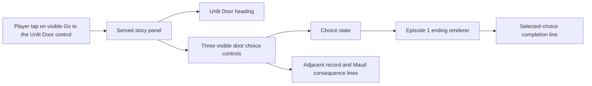
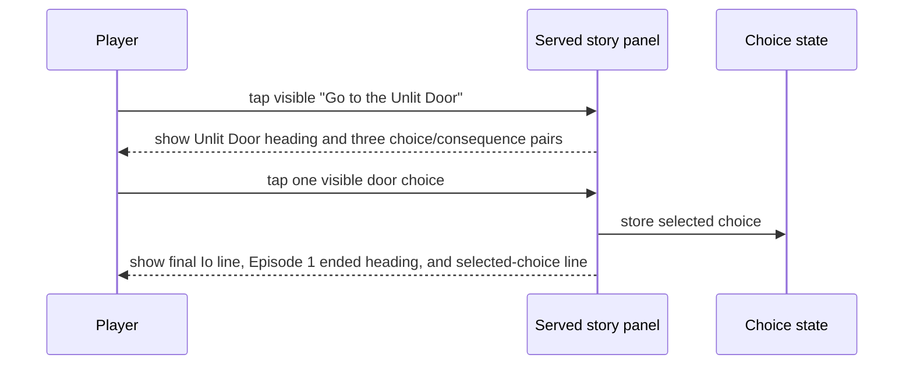

# Design — #2894 Unlit Door choice and ending

**Story:** #2894 · **Spec:** [docs/specs/2894-unlit-door-choice-and-ending.md](../specs/2894-unlit-door-choice-and-ending.md) · **Architecture:** [docs/plan/architecture/README.md](../plan/architecture/README.md)

## Components

The served story panel owns the visible location heading, choice controls, consequence lines, and ending status. Existing Unlit Door choice state identifies the tapped choice; the ending renderer reads that state to name only the selected choice.

## Flow

## Data

The design reads the existing selected Unlit Door choice state after a visible choice tap. It does not add a save field, key, or persistence rule; build work must preserve the existing durable-choice behavior.

## Test map

| AC | Test file | Test name | Fails on main because |
|---|---|---|---|
| AC-1 | `aftersign/e2e/durable-act-ii-ending.spec.ts` | `shows the named Unlit Door after a visible phone tap` | Main does not assert the named heading or removal of prior controls. |
| AC-2 | `aftersign/e2e/durable-act-ii-ending.spec.ts` | `shows all three visible record and Maud consequences at the Unlit Door` | Main does not assert consequence copy or viewport containment. |
| AC-3 | `aftersign/e2e/episode-one-ending-served.spec.ts` | `shows Episode 1 completion and the visibly tapped door choice` | Main does not assert the completion heading and selected-choice line together. |
| AC-4 | `aftersign/e2e/episode-one-ending-served.spec.ts` | `does not claim an Unlit Door action the player did not tap` | Main does not assert copy against each visibly tapped choice. |

## Risks

- Long consequence copy can clip on a 390×844 viewport; build work must prove all three choice pairs fit without a swipe.
- Reusing copy from an unselected path would violate the story's no-false-memory rule.
