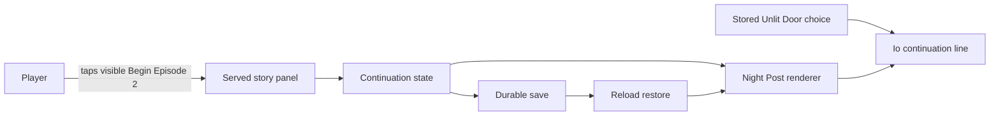
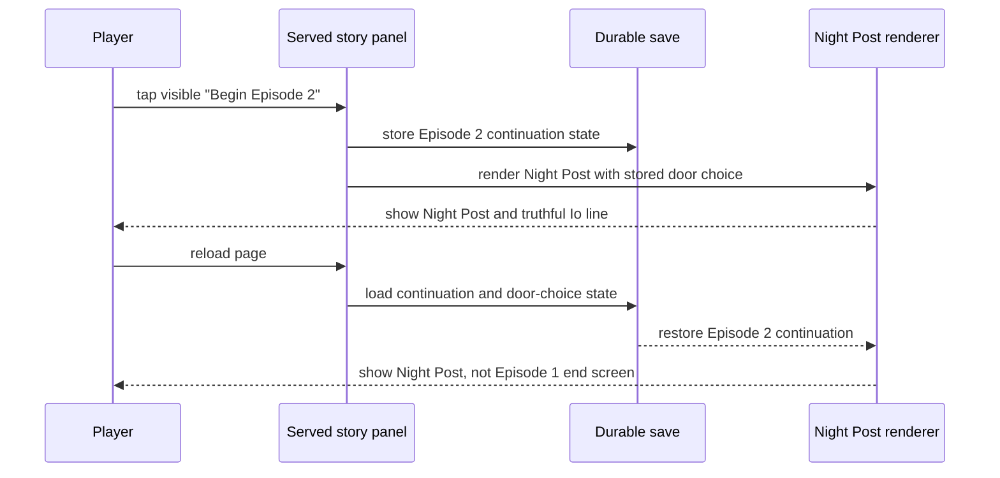

# Design — #2895 Episode 2 continuation from the Episode 1 end screen

**Story:** #2895 · **Spec:** [docs/specs/2895-episode-two-continuation.md](../specs/2895-episode-two-continuation.md) · **Architecture:** [docs/plan/architecture/README.md#client-components](../plan/architecture/README.md#client-components)

## Components

The served story panel renders the durable Episode 1 end screen and its visible **Begin Episode 2** control. Continuation state distinguishes an Episode 1 end screen from the Episode 2 Night Post. The existing selected Unlit Door choice is read by the Night Post Io renderer, while durable save/load restores both the continuation state and that choice.

## Flow

## Data

Build work adds a durable continuation-state value that records the Episode 2 Night Post after the player taps **Begin Episode 2**. It reads the existing selected Unlit Door choice and preserves it through reload. It must not rewrite the selected choice or derive an Io line from an unselected door.

## Test map

| AC | Test file | Test name | Fails on main because |
|---|---|---|---|
| AC-1 | `aftersign/e2e/episode-two-continuation-served.spec.ts` | `shows a tap-reachable Begin Episode 2 control on the phone end screen` | Main has no served-page assertion for the visible continuation control. |
| AC-2 | `aftersign/e2e/episode-two-continuation-served.spec.ts` | `enters the Night Post after tapping Begin Episode 2` | Main has no visible-control flow from the Episode 1 end screen to the Night Post or lockout assertion. |
| AC-3 | `aftersign/e2e/episode-two-continuation-served.spec.ts` | `names only the visibly selected Unlit Door choice at the Night Post` | Main has no continuation assertion that compares Io copy with the player-tapped door choice. |
| AC-4 | `aftersign/e2e/episode-two-continuation-served.spec.ts` | `restores the Night Post continuation after reload` | Main has no served-page reload assertion for durable Episode 2 continuation state. |

## Risks

- A control that is only programmatically invoked would violate C2; each test must tap/click the rendered `Begin Episode 2` control at 390×844 and use `window.__game` only to assert results.
- Copy shared across choices could name an action the player did not take; the test must exercise every stored choice.
- Saving the new continuation state without restoring it would return players to the Episode 1 end screen after reload.
