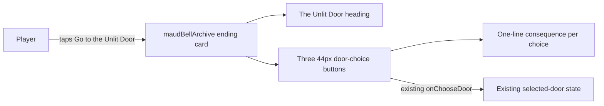
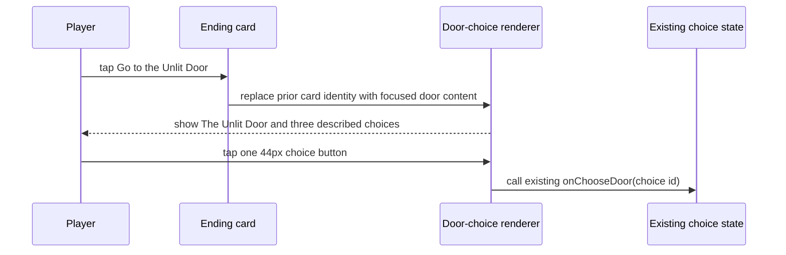

# Design — #2992 Unlit Door focused choice card

**Story:** #2992 · **Delivery task:** #2999 · **Spec:** [docs/specs/2992-unlit-door-focused-choice-card.md](../specs/2992-unlit-door-focused-choice-card.md) · **Architecture:** [docs/plan/architecture/README.md#runtime-boundaries](../plan/architecture/README.md#runtime-boundaries)

## Components

`aftersign/src/maudBellArchive.js` owns the rendered Episode 1 ending card. Its open-door branch changes the heading and renders the three choice-and-consequence pairs. Build work changes that branch to use **The Unlit Door**, to retain only those pairs, to make their buttons 44px or taller, and to describe the private lie as the false name placed in the record. The existing `onChooseDoor` callback remains the sole writer of the selected choice.

## Flow

## Data

The build reads the existing ending name to interpolate the current consequence lines and writes no new save field, key, or persistence rule. The existing `onChooseDoor(choice id)` route continues to record the selected choice. The focused card is transient UI derived from the existing `maudBellArchiveDoorOpen` state.

## Test map

| AC | Test file | Test name | Fails on main because |
|---|---|---|---|
| AC-1 | `aftersign/e2e/m4-act-two.playtest.spec.ts` | `shows The Unlit Door instead of the Bell Archive after the visible door tap` | Current renderer uses `Unlit Door`, not the required heading text. |
| AC-2 | `aftersign/e2e/m4-act-two.playtest.spec.ts` | `renders only the three door choices on the opened door card` | Current coverage does not assert the focused-card control set. |
| AC-3 | `aftersign/e2e/m4-act-two.playtest.spec.ts` | `describes every door choice and names the private lie` | Current private-lie consequence says only that its record is sealed. |
| AC-4 | `aftersign/e2e/m4-act-two.playtest.spec.ts` | `keeps three 44px door choices and descriptions inside the phone card` | Current renderer sets each choice button's minimum height to 32px and current coverage does not assert the choice-pair bounds. |

## Risks

- Increasing the choice height can exceed the bounded phone panel; the implementation must prove the complete focused card is visible at 390×844.
- Changing consequence text must preserve the selected-choice receipt and never attribute an unselected action to the player.
