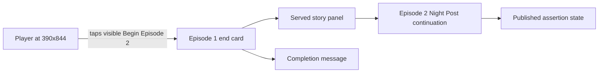
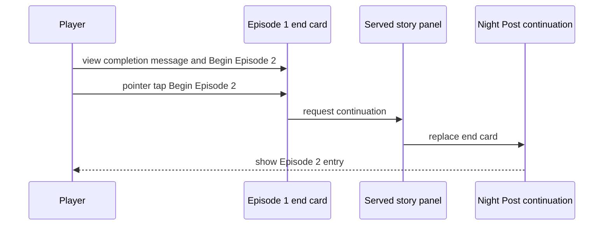

# Design — #2993 Episode 2 entry

**Issue:** [#3007](https://github.com/phynars/oodim-game/issues/3007) · **Story:** #2993 · **Spec:** [docs/specs/2993-episode-two-entry.md](../specs/2993-episode-two-entry.md) · **Architecture:** [docs/plan/architecture/README.md#act-iii-the-unlit-door-shipped](../plan/architecture/README.md#act-iii-the-unlit-door-shipped)

## Components

The committed Episode 1 end card owns the visible completion message and **Begin Episode 2** control. The served story panel receives the player's pointer tap and moves to the Episode 2 Night Post continuation. The test reads the rendered panel and may inspect published state only after the visible control causes the transition.

## Flow

## Data

This slice introduces no new saved data. The completion message and visible control are rendered on the committed Episode 1 end card. The tap transitions the served panel to its existing Episode 2 Night Post continuation; the test asserts the rendered result after that player-caused action.

## Test map

| AC | Test file | Test name | Fails on main because |
|---|---|---|---|
| AC-1 | `aftersign/e2e/episode-two-continuation-served.spec.ts` | `shows a tap-reachable Begin Episode 2 control on the phone end screen` | Existing served test already asserts the exact visible completion message; this spec stage adds no test. |
| AC-2 | `aftersign/e2e/episode-two-continuation-served.spec.ts` | `shows a tap-reachable Begin Episode 2 control on the phone end screen` | Existing served test already asserts the visible control, 56px minimum height, no clipping, and a trial tap; this spec stage adds no test. |
| AC-3 | `aftersign/e2e/episode-two-continuation-served.spec.ts` | `enters the Night Post after tapping Begin Episode 2` | Existing served test taps `#beginEpisodeTwo`, asserts the Night Post continuation, and later asserts the Episode 1 control and ending id are absent; this spec stage adds no test. |

## Risks

- A transition invoked through `window.__game` would violate C2; the test must use a pointer tap on the rendered control and reserve published state for assertions.
- A completion message that is hidden below the fold would make episode status unclear at the phone viewport; the test must inspect the visible rendered card.
- Retaining an Episode 1 control after the transition would make the current episode ambiguous; the post-tap test must assert its absence.
