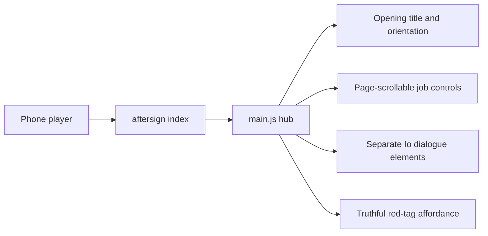
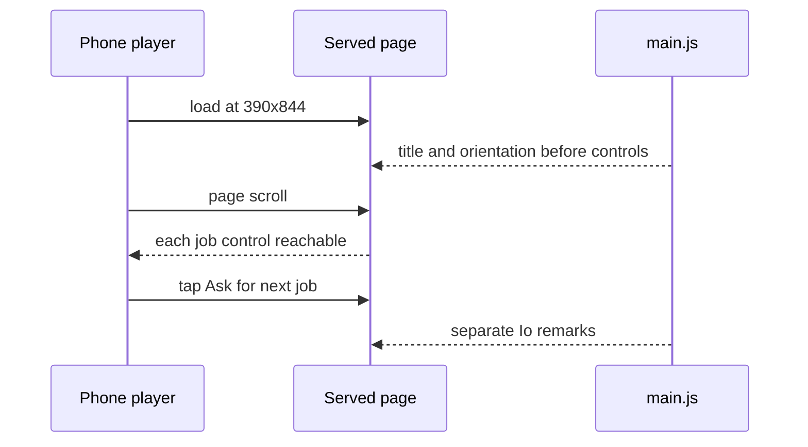

# Design — #2994 Titled intro, readable jobs, and Io dialogue

**Story:** #2994 · **Spec:** [spec](../specs/2994-titled-intro-readable-jobs-and-io.md) · **Architecture:** [Client components](../plan/architecture/README.md#client-components)

## Components

`aftersign/index.html` loads the `aftersign/main.js` hub. The later build identifies the existing first-job, second-job, Io-response, and red-tag render paths. It changes only presentation order, page-level reachability, dialogue element boundaries, and the red-tag element type. The visible Ask for next job control is already exercised by existing e2e coverage with `button[data-choice-id="ask-for-next-job"]`.

## Flow

## Data

The build reads existing beat, offered-job, packet, and dialogue state. It adds no save fields and changes no durable state rules.

## Test map

These are proposed, unimplemented served Playwright tests. They must be written failing first on main and use visible controls and page scrolling at 390×844.

| AC | Proposed test file | Test name | Must fail on main because |
|---|---|---|---|
| AC-1 | `aftersign/e2e/titled-intro-readable-jobs-and-io.spec.ts` | `shows AFTERSIGN and orientation before the first job control at 390x844` | The initial ordering is not pinned by this served test. |
| AC-2 | `aftersign/e2e/titled-intro-readable-jobs-and-io.spec.ts` | `reaches every second-job control by page scrolling at 390x844` | Page-level reachability for the complete list is not pinned by this served test. |
| AC-3 | `aftersign/e2e/titled-intro-readable-jobs-and-io.spec.ts` | `renders each Io remark separately after tapping Ask for next job` | Element boundaries after the player action are not pinned by this served test. |
| AC-4 | `aftersign/e2e/titled-intro-readable-jobs-and-io.spec.ts` | `does not expose a non-transitioning Red tag — Saint Orra button` | The affordance is not pinned against its visible-state effect. |

## Risks

- DOM presence does not prove a job control is player-reachable; later tests must demonstrate page-level reachability.
- The hub can update internal state without a player-visible result; tests must operate visible controls.
- The later build must read the existing red-tag action path before changing its markup.
