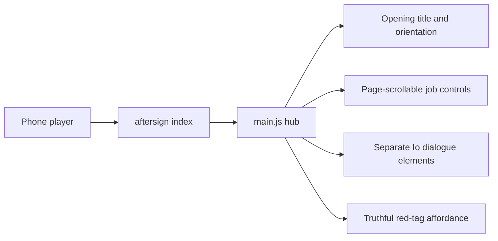
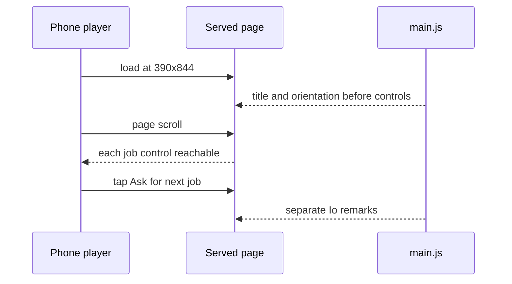

# Design — #2994 Titled intro, readable jobs, and Io dialogue

**Story:** #2994 · **Spec:** [spec](../specs/2994-titled-intro-readable-jobs-and-io.md) · **Architecture:** [Client components](../plan/architecture/README.md#client-components)

## Components

`aftersign/index.html` loads the `aftersign/main.js` hub. The later build identifies the existing first-job, second-job, Io-response, and red-tag render paths. It changes only presentation order, page-level reachability, dialogue element boundaries, and the red-tag element type. The visible Ask for next job control is already exercised by existing e2e coverage with `button[data-choice-id="ask-for-next-job"]`.

## Flow

## Data

The build reads existing beat, offered-job, packet, and dialogue state. It adds no save fields and changes no durable state rules.

## Test map

These are proposed, unimplemented served Playwright tests. Each uses visible controls and page scrolling at 390×844.

The build stage runs each test on main before it changes the runtime and records the result in the PR's Evidence. The third column gives the expected failure and the main-branch code behind it. A test that passes on main is a regression guard, not a fix. The PR must call it that and must not claim it closes the matching criterion with a change.

| AC | Proposed test file | Test name | Expected red on main (to confirm first) |
|---|---|---|---|
| AC-1 | `aftersign/e2e/titled-intro-readable-jobs-and-io.spec.ts` | `shows AFTERSIGN and orientation before the first job control at 390x844` | **May already pass.** The start screen in `aftersign/index.html` has `<h1>AFTERSIGN</h1>` and `#startScreenMessage` before `#beginButton`. If the test is green on main, the build treats AC-1 as a regression guard and changes nothing for it. |
| AC-2 | `aftersign/e2e/titled-intro-readable-jobs-and-io.spec.ts` | `reaches every second-job control by page scrolling at 390x844` | `.panel` in `aftersign/index.html` sets `max-height: calc(100dvh - 36px)`, `overflow-y: auto` and `overscroll-behavior: contain`. Job controls below the card's fold can be reached only by scrolling inside the card, so the assertion that page scroll alone brings each control into view should fail. |
| AC-3 | `aftersign/e2e/titled-intro-readable-jobs-and-io.spec.ts` | `renders each Io remark separately after tapping Ask for next job` | Io dialogue renders into the single `#line` paragraph (`createDialogueController({ line, speaker })` in `aftersign/main.js`). An Io turn that has more than one remark shares one element, so an assertion of one element per remark should fail. |
| AC-4 | `aftersign/e2e/titled-intro-readable-jobs-and-io.spec.ts` | `does not expose a non-transitioning Red tag — Saint Orra button` | On a red-tag reload, `aftersign/main.js` sets `#packetButton` (a `<button>`) to `textContent = "Red tag — Saint Orra"`. The test taps it and asserts that visible state changes or that the label is not a button. It should fail if the tap changes nothing. |

## Risks

- DOM presence does not prove a job control is player-reachable; later tests must demonstrate page-level reachability.
- The hub can update internal state without a player-visible result; tests must operate visible controls.
- The later build must read the existing red-tag action path before changing its markup.
