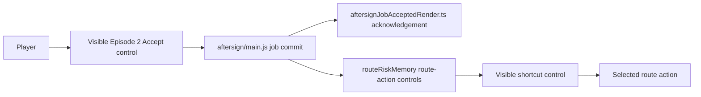
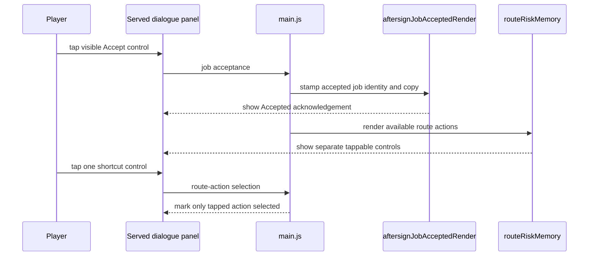

# Design — #3031 Accepted job shortcut choices

**Story:** #3031 · **Spec:** [docs/specs/3031-job-acceptance-shortcut-choices.md](../specs/3031-job-acceptance-shortcut-choices.md) · **Architecture:** [docs/plan/architecture/README.md#client-components](../plan/architecture/README.md#client-components)

## Components

The build keeps job acceptance, route-action rendering, and route-action selection separate. `main.js` commits the visible job-offer tap and supplies the accepted job identity to `aftersignJobAcceptedRender.ts`; that renderer adds the acknowledgement beside the dialogue line. `routeRiskMemory` renders available route actions as controls. The route-choice container records a selected action only after its own control is tapped.

## Flow

## Data

The acknowledgement uses the accepted job identity for the current served beat. Route-action selection remains a separate action identity. A restore that contains job acceptance but no route-action selection must render no selected shortcut; the build must not derive a route selection from the acceptance identity.

## Test map

| AC | Test file | Test name | Fails on main because |
|---|---|---|---|
| AC-1 | `aftersign/e2e/job-acceptance-shortcut-choices.spec.ts` | `accepting an Episode 2 job shows Accepted before route selection` | No served-page, pointer-driven test establishes the acknowledgement-before-selection contract. |
| AC-2 | `aftersign/e2e/job-acceptance-shortcut-choices.spec.ts` | `accepted job exposes separate visible shortcut controls` | No served-page, pointer-driven test establishes the post-acceptance shortcut tray contract. |
| AC-3 | `aftersign/e2e/job-acceptance-shortcut-choices.spec.ts` | `tapping a shortcut selects only the tapped action` | No single served-page flow ties the Accept tap to a subsequent visible shortcut tap and checks their separate meanings. |
| AC-4 | `aftersign/e2e/job-acceptance-shortcut-choices.spec.ts` | `restoring accepted job without shortcut has no selected shortcut` | No regression test protects restore from deriving a route action from acceptance. |

## Risks

- The accepted-job acknowledgement and route-action selection can be conflated if a build uses one identity for both facts.
- A harness mutation could appear to prove the flow without exercising visible controls; the planned test must use pointer taps on the served page and use `window.__game` only for assertions.
- Restore behaviour must be verified from the runtime owner during build; this design specifies the required observable state rather than assuming a persistence implementation.
