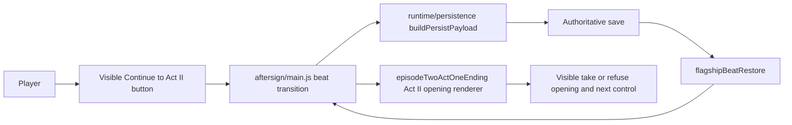
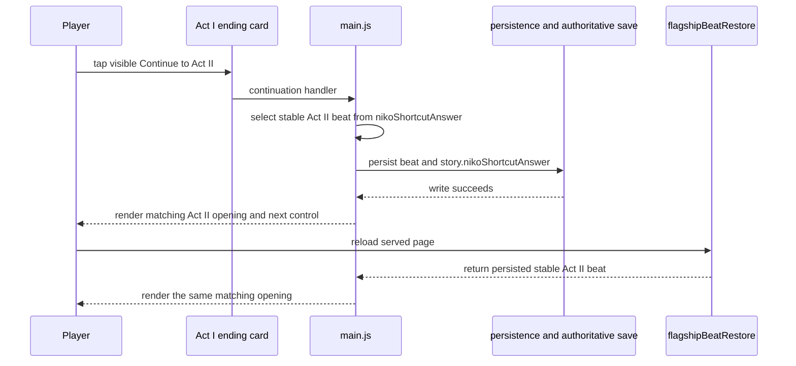

# Design — #3032 Act I end-card continuation into Act II

**Story:** #3032 · **Spec:** [Act I end-card continuation into Act II](../specs/3032-act-i-end-card-act-ii-continuation.md) · **Architecture:** [AFTERSIGN at a glance](../plan/architecture/README.md#aftersign-at-a-glance)

## Components

`aftersign/src/episodeTwoActOneEnding.js` currently renders the Act I ending card and its current-content button. The build replaces that terminal affordance with the visible continuation control and renders two Act II opening cards. `aftersign/main.js` owns beat transitions and invokes persistence. `aftersign/src/runtime/persistence.js` already serializes `scene.beat` and validates `story.nikoShortcutAnswer` as `take` or `refuse`; `aftersign/src/runtime/flagshipBeatRestore.js` returns persisted beats unchanged except for listed legacy migrations and `packet-delivered`. The build adds stable Act II opening beat ids to that existing durable transition, rather than assuming a default at boot.

**Which state drives restore.** Today the Act I ending card is gated by the `story.episodeTwoActOneEnded` flag, not by a beat: `main.js` checks `state.story.episodeTwoActOneEnded && episodeTwoActOneEnding` (main.js:1697) and re-renders the ending card on every frame while it is true; the flag is set at main.js:1824 and persisted at persistence.js:82. For Act II, the **beat** is the source of truth: the stable Act II beat id decides that an Act II opening renders, and `story.nikoShortcutAnswer` decides which one. `episodeTwoActOneEnded` stays `true` as a record that Act I finished; it is not cleared and does not gate Act II. The build must therefore put the Act II beat check **before** the `episodeTwoActOneEnded` gate at main.js:1697, so a restored Act II beat is not overdrawn by the ending card.

## Flow

## Data

The existing persistence payload stores `beat` from `state.scene.beat` and stores `story.nikoShortcutAnswer` only when its value is `take` or `refuse`. The implementation must set a stable Act II beat before persistence and retain the shortcut answer already selected in story state. On hydration, `restoreFlagshipBeat` preserves those new stable beat ids because they are not legacy migrations and are not `packet-delivered`; the renderer then derives the matching opening from the restored answer. No browser-local storage assumption is required: the existing persistence helper writes the same payload through the authoritative path.

## Test map

| AC | Test file | Test name | Fails on main because |
|---|---|---|---|
| AC-1 | `aftersign/e2e/act-i-end-card-act-ii-continuation.playtest.spec.ts` | `shows and taps Continue to Act II from the Act I ending card at 390x844` | The current card labels its only action as current content, not `Continue to Act II`. |
| AC-2 | `aftersign/e2e/act-i-end-card-act-ii-continuation.playtest.spec.ts` | `opens the take Act II card from the visible continuation control` | Main has no Act II opening or stable Act II scene id after the take branch. |
| AC-3 | `aftersign/e2e/act-i-end-card-act-ii-continuation.playtest.spec.ts` | `opens the refuse Act II card from the visible continuation control` | Main has no Act II opening or stable Act II scene id after the refuse branch. |
| AC-4 | `aftersign/e2e/act-i-end-card-act-ii-continuation.playtest.spec.ts` | `restores each selected Act II opening after reload` | Main persists the answer but only renders a current-content ending rather than an Act II opening. |

## Risks

- The ending-card gate at main.js:1697 runs on `episodeTwoActOneEnded`, which stays `true` in Act II. If the Act II beat check is not placed ahead of it, reload restores the right beat but still draws the Act I ending card; AC-4 catches this.
- The Act II beat must be set before the save write; persisting only `nikoShortcutAnswer` would leave reload without a stable opening target.
- The e2e tests must click the rendered continuation button, not mutate state through `window.__game`.
- The two branches must differ in copy, scene id, and visible next control; a hidden answer field alone does not meet the story outcome.
