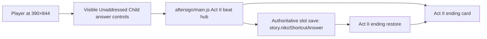
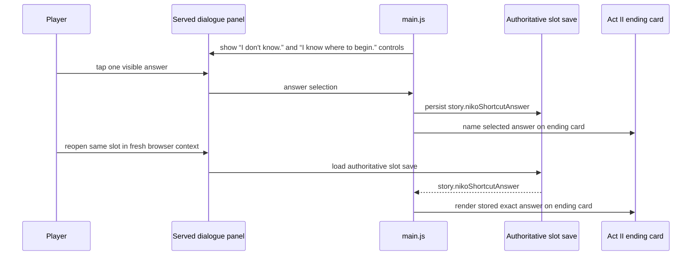

# Design — #3033 Unaddressed Child answer

**Story:** #3033 · **Spec:** [docs/specs/3033-unaddressed-child-answer.md](../specs/3033-unaddressed-child-answer.md) · **Architecture:** [docs/plan/architecture/README.md#client-components](../plan/architecture/README.md#client-components)

## Components

The build is planned to add the Act II transition and visible answer controls to the served dialogue flow, carry `story.nikoShortcutAnswer` through the authoritative slot save, and read that field when rendering the Act II ending. This documentation pass does not verify the current owning runtime modules.

## Flow

## Data

`story.nikoShortcutAnswer` is a durable slot field with one of two exact values: `i-dont-know` for **"I don't know."** and `i-know-where-to-begin` for **"I know where to begin."** `main.js` writes it after a visible answer tap; authoritative save restoration supplies it on a fresh browser context. The Act II ending card renders the matching visible label. Existing slots without the field remain outside this story's scope.

## Test map

| AC | Test file | Test name | Fails on main because |
|---|---|---|---|
| AC-1 | Planned: `aftersign/e2e/unaddressed-child-answer.spec.ts` | `shows both Unaddressed Child answers as tappable visible controls at 390x844` | The build must establish this served-page interaction; this docs-only PR adds no test. |
| AC-2 | Planned: `aftersign/e2e/unaddressed-child-answer.spec.ts` | `persists each tapped Unaddressed Child answer in the authoritative slot save` | The build must establish this durable-save assertion; this docs-only PR adds no test. |
| AC-3 | Planned: `aftersign/e2e/unaddressed-child-answer.spec.ts` | `names the selected Unaddressed Child answer on the Act II ending card` | The build must establish this ending-card assertion; this docs-only PR adds no test. |
| AC-4 | Planned: `aftersign/e2e/unaddressed-child-answer.spec.ts` | `restores the selected Unaddressed Child answer on the Act II ending card in a fresh browser context` | The build must establish this fresh-context assertion; this docs-only PR adds no test. |

## Risks

- A client-retained value could mask a missing authoritative restore; the fresh-context test must use the same slot and assert the ending after reopening it.
- A test that mutates `window.__game` would not prove player reachability; every route to the answer must use pointer taps on visible controls.
