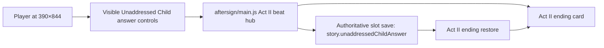
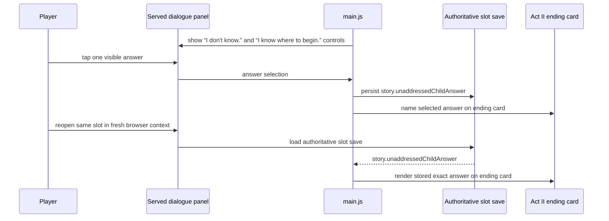

# Design — #3033 Unaddressed Child answer

**Story:** #3033 · **Spec:** [docs/specs/3033-unaddressed-child-answer.md](../specs/3033-unaddressed-child-answer.md) · **Architecture:** [docs/plan/architecture/README.md#client-components](../plan/architecture/README.md#client-components)

## Components

The build is planned to add the Act II transition and visible answer controls to the served dialogue flow, carry a new field, `story.unaddressedChildAnswer`, through the authoritative slot save, and read that field when rendering the Act II ending.

Owning code sites (checked on this branch):

- `aftersign/src/runtime/persistence.js:83-85` — the save serializer whitelists `story.nikoShortcutAnswer` to `take`/`refuse`. The build adds a sibling `unaddressedChildAnswer` entry whitelisted to `i-dont-know`/`i-know-where-to-begin`, else `null`.
- `aftersign/main.js:1239-1242` — restore from the stored save, same whitelist pattern; the build adds the matching `unaddressedChildAnswer` restore.
- `aftersign/main.js:1799-1820` — the Niko choice handler and Act I end-card receipt own `story.nikoShortcutAnswer` (guarded by `if (state.story.nikoShortcutAnswer) return;`). The Child answer must not touch this field or this guard.
- `aftersign/main.js:5917` — Start fresh clears `nikoShortcutAnswer`; the build also clears `unaddressedChildAnswer` there.
- `aftersign/src/episodeTwoActOneEnding.js:10` reads `nikoShortcutAnswer` for the Act I ending; it is not changed.

The current Act II route has no Unaddressed Child code yet (no `unaddressed` match under `aftersign/main.js` or `aftersign/src`), so the question and controls are new.

## Flow

## Data

`story.unaddressedChildAnswer` is a new durable slot field, separate from `story.nikoShortcutAnswer` (which keeps only `take`/`refuse` and is never written by this story). It takes one of two exact values: `i-dont-know` for **"I don't know."** and `i-know-where-to-begin` for **"I know where to begin."** `main.js` writes it after a visible answer tap; authoritative save restoration supplies it on a fresh browser context. The Act II ending card renders the matching visible label. Existing slots without the field remain outside this story's scope.

## Test map

| AC | Test file | Test name | Fails on main because |
|---|---|---|---|
| AC-1 | Planned: `aftersign/e2e/unaddressed-child-answer.spec.ts` | `shows both Unaddressed Child answers as tappable visible controls at 390x844` | The build must establish this served-page interaction; this docs-only PR adds no test. |
| AC-2 | Planned: `aftersign/e2e/unaddressed-child-answer.spec.ts` | `persists each tapped Unaddressed Child answer in the authoritative slot save` | The build must establish this durable-save assertion; this docs-only PR adds no test. |
| AC-3 | Planned: `aftersign/e2e/unaddressed-child-answer.spec.ts` | `names the selected Unaddressed Child answer on the Act II ending card` | The build must establish this ending-card assertion; this docs-only PR adds no test. |
| AC-4 | Planned: `aftersign/e2e/unaddressed-child-answer.spec.ts` | `restores the selected Unaddressed Child answer on the Act II ending card in a fresh browser context` | The build must establish this fresh-context assertion; this docs-only PR adds no test. |

## Risks

- Reusing `story.nikoShortcutAnswer` would be dropped by the `take`/`refuse` whitelists in persistence.js and main.js restore, and blocked by the Niko guard at main.js:1819; the separate field avoids this. AC-2 should also assert `nikoShortcutAnswer` is unchanged after the Child answer.
- A client-retained value could mask a missing authoritative restore; the fresh-context test must use the same slot and assert the ending after reopening it.
- A test that mutates `window.__game` would not prove player reachability; every route to the answer must use pointer taps on visible controls.
