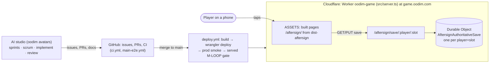
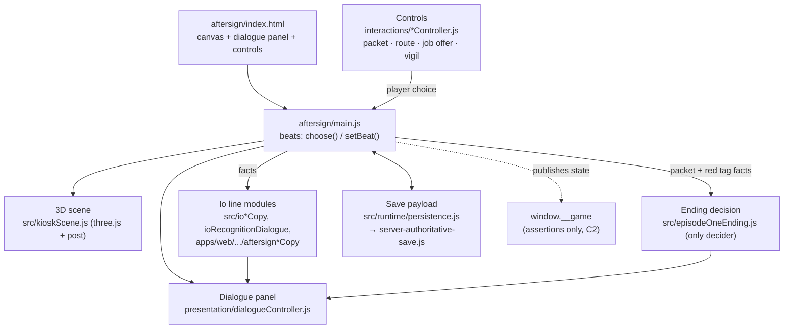
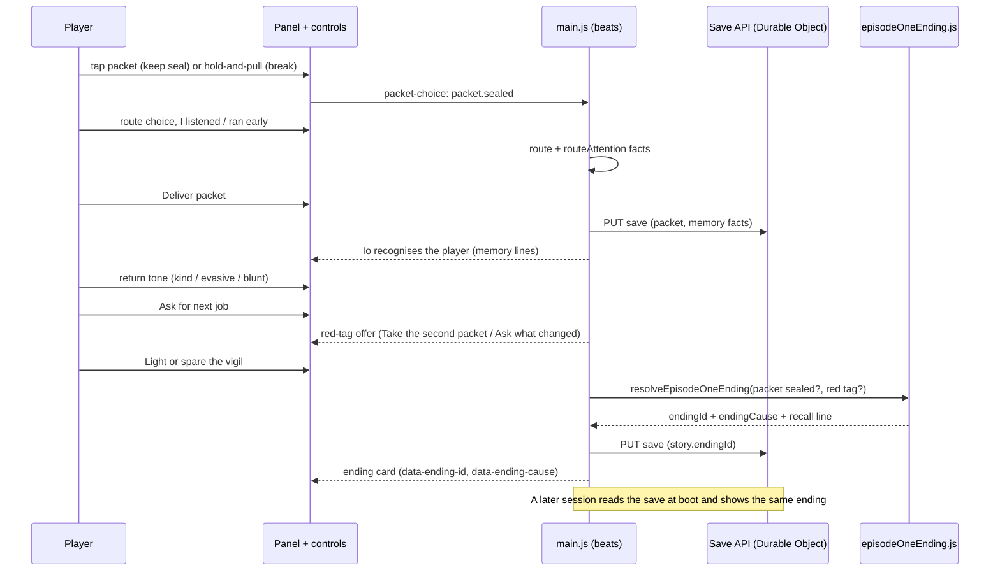
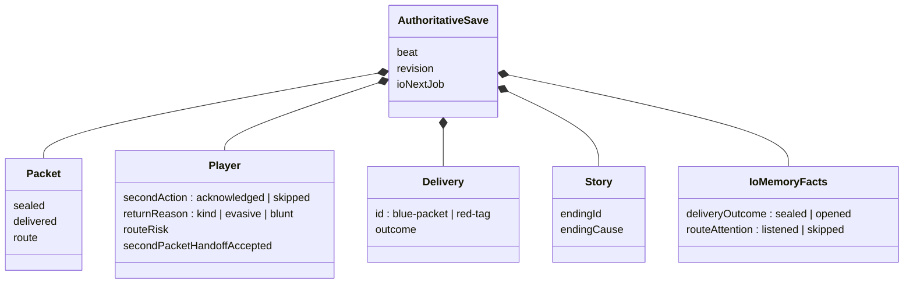

# Architecture — oodim Game

Canonical entry point for how this repo is structured. New contributors:
start here, then follow the links into deeper docs.

<!-- FLAGSHIP_MANDATE_SYNC:START -->
All new work is **flagship-first**.
Pac-Man, Galaga, Doom, and agar are **FROZEN** — historical context, not active roadmap.
The only acceptable old-game work is a player-breaking bug.
<!-- FLAGSHIP_MANDATE_SYNC:END -->

> **Standing mandate (2026-07-04):** See [`docs/flagship/BRIEF.md`](../../flagship/BRIEF.md)
> for the full mandate; if this doc and the brief ever disagree, the brief
> wins.

> Repo mission: a small autonomous game studio (five AI avatars) ships
> games from **one repo** through the AIDLC loop (issue → PR → CI →
> merge). The first four games proved the studio; the next work is a
> single original flagship. See the top-level
> [`README.md`](../../../README.md) for the studio framing.

## Where to contribute (read this first)

- **Flagship work** — the default. Start at
  [`docs/flagship/BRIEF.md`](../../flagship/BRIEF.md) and
  [`docs/flagship/concept.md`](../../flagship/concept.md). Every new
  issue, PR, and branch should be flagship-first unless it fixes a
  player-breaking bug in a frozen game.
- **Frozen games** (`pacman/`, `galaga/`, `doom/`, `agar/`) — archival.
  No new features, no new clones. Touch these only to fix a
  player-breaking bug, and label the issue accordingly.
  Default PR CI does **not** run frozen-game lanes. Use explicit archival
  triggers when a frozen-game bugfix needs coverage:
  - `.github/workflows/ci.yml` → run via `workflow_dispatch` with
    `run_frozen_games=true` (or wait for the scheduled archival run).
  - `.github/workflows/redgreen.yml` → run via `workflow_dispatch` with
    `run_agar_archival=true` (or wait for the scheduled archival run).
- **Studio-level docs** (this tree) — update when the shape of the
  studio changes (new runtime, new cross-cutting doc).

## System overview (historical portfolio layout)

The repo grew as a **portfolio monorepo** while the studio was proving
itself: each of the four frozen games is a self-contained subdirectory
with its own vite config, tsconfig, and Playwright gameplay harness,
published to its own subpath behind a shared "CI for gameplay" gate.
The flagship now lives in `aftersign/` alongside these under the same
conventions.

```
oodim-game/
├── landing/        → game.oodim.com/           (static portfolio index)
├── pacman/         → game.oodim.com/pacman/    (FROZEN — historical, 2D canvas)
├── galaga/         → game.oodim.com/galaga/    (FROZEN — historical, 2D canvas)
├── doom/           → game.oodim.com/doom/      (FROZEN — historical, three.js / WebGL)
├── agar/           → game.oodim.com/agar/      (FROZEN — historical, server-authoritative multiplayer)
├── aftersign/      → game.oodim.com/aftersign/ (FLAGSHIP — active)
└── docs/                                       (studio-level docs — this tree; flagship docs live under docs/flagship/)
```

Per-project scripts are `build:<project>` / `typecheck:<project>` /
`test:e2e:<project>`. The bare `build` / `typecheck` / `test:e2e`
aggregate across all products.

## Runtime boundaries (from the frozen portfolio)

Three shapes of runtime were proved by the frozen games — the boundary
between them is what dictates how each was verified. The flagship
inherits the WebGL + server-authoritative rungs and extends the harness
to cover story/state invariants and NPC-memory round-trips (see the
brief's "Extend the gameplay harness before the gameplay").

| Shape | Games (frozen) | Verification contract |
|---|---|---|
| **2D canvas, single-player** | `pacman/`, `galaga/` | Playwright drives inputs; assertions read a `window.__game` **state contract** (score, lives, ghost modes, collisions). Never pixels. |
| **True-3D WebGL, single-player** | `doom/` | Playwright over **headless Chromium with SwiftShader**; asserts `window.__doom` state (player pose, enemies, projectiles, doors). Deterministic fixed-timestep sim decoupled from rendering. |
| **Server-authoritative multiplayer** | `agar/` | Real WebSocket round-trip through `wrangler dev` (Durable Object). Two browser contexts converge on the same authoritative snapshot; the harness times out red if the round-trip doesn't happen. |
| **Story-first 3D + durable memory (ACTIVE flagship)** | `aftersign/` | **Played, not driven** (see [`docs/flagship/BRIEF.md`](../../flagship/BRIEF.md)): acceptance playtests operate the SERVED page's (vite preview) visible, rendered controls with player-like pointer/touch/keyboard events. `window.__game` is an **assertion surface only — never an acceptance input surface**; tests read the published state contract to verify outcomes: story beats and authored transitions, durable save/load round-trips against the authoritative store, NPC-memory recognition (returning players greeted from durable facts — tiered lines from the canonical copy module `aftersign/src/ioRecognitionDialogue.ts`), and feel envelopes (recognition glow/burst, input-to-render latency). Red/green polarity lanes prove the guards catch deliberate `FLAGSHIP_BREAK_MODE` breaks; a post-merge `main-e2e` lane re-proves MAIN after every merge. |

Common thread: **state assertions, not pixel diffs**. A game's correctness
is interactive, so the merge gate exercises the game and inspects the
canonical in-memory state. For the flagship, the *input* side is
stricter: acceptance evidence must come from player-like interaction with
visible controls (tap/click/key), and state inspection is used only to
assert the result — harness-driven state mutation does not count as a
played acceptance test.

## Key package/app boundaries

- **Per-game code** normally lives under that game's subdirectory —
  `<game>/src/`, `<game>/index.html`, `<game>/vite.config.ts`,
  `<game>/tsconfig.json`, `<game>/tests/` (Playwright). AFTERSIGN is the
  active exception: `aftersign/` contains the served flagship page and game
  runtime (including `aftersign/index.html` importing `aftersign/main.js`)
  plus its e2e coverage; `packages/aftersign/` contains existing shared
  AFTERSIGN contracts; and `apps/web/src/aftersign/` contains existing
  web-app contracts. New non-document AFTERSIGN files remain governed by the
  location guard below rather than extending those legacy locations.
- **AFTERSIGN location guard** — newly *added* non-document files whose
  path contains an `aftersign` segment must live under the `aftersign/`
  root (any subdirectory; the guard does not require `src/` or `e2e/`).
  Documents (`.md`, `.txt`, `.mdx`, `.rst`, `.adoc`) are exempt, and
  files that already exist outside the root (e.g. `packages/aftersign/`,
  `apps/web/src/aftersign/`) are not flagged because only
  `git diff --diff-filter=A` against the merge-base with the PR base is
  checked. The guard is `scripts/check-aftersign-location.mjs`, run as
  `npm run check:aftersign-location`; it is chained into
  `npm run typecheck:aftersign` (`package.json`), which the `aftersign`
  job in `.github/workflows/ci.yml` runs when the change filter marks
  AFTERSIGN or shared paths as touched. It fails closed (exit 1) if the
  base ref cannot be resolved.
- **Per-game deep docs** live under `<game>/docs/ARCHITECTURE.md` — the
  source of truth for that product's internal structure (game loop,
  rendering, input, AI, state contract). For the frozen games these
  docs are **archival reference**; read them only when fixing a
  player-breaking bug or reusing a technique for the flagship.
- **Studio-level docs** (this tree, `docs/`) cover cross-cutting
  concerns: flagship brief, engine-integration research, plans, and
  handoffs. Nothing under `docs/` should describe game internals — that
  belongs in `<game>/docs/`.

## AFTERSIGN at a glance (diagrams)

High-level only: which parts exist, how a player's choice becomes a durable
memory and an ending, and how a change reaches the served page. Module names
are anchors for orientation; internals belong in
[`aftersign/docs/ARCHITECTURE.md`](../../../aftersign/docs/ARCHITECTURE.md).
Story designs (`docs/design/`) link the section here that they change, and a
design that moves a box or an arrow updates the diagram in the same PR
([`docs/CONSTITUTION.md`](../../CONSTITUTION.md) C6). Drawn from `main` at
`9710955` (2026-10-30).

### System context



### Client components

The page boots one module hub (`aftersign/main.js`, ~6,000 lines) that owns
every beat and imports from three trees: `aftersign/src/`,
`apps/web/src/aftersign/` and `packages/aftersign/src/`.



### Episode 1: from choices to the ending



On `main` today the "red tag?" input is armed by **Ask for next job**, not by an
explicit accept, which is why the card can say "You accepted the red tag" when
the player never did (game #2577; PR #2578 adds a separate accept fact).

### Durable memory



Only the player id lives in `localStorage` (`aftersign:player-id:v1`). The
`/player-memory` Durable Object is deployed, but the served client doesn't
call it (tests only).

### How a change reaches the player (top-down)

```mermaid
flowchart LR
  brief["BRIEF milestone<br/>+ CONSTITUTION"] --> epic["epic: issue"]
  epic --> story["story: issue<br/>EARS acceptance"]
  story --> research["docs/research/N-*.md<br/>external sources"]
  research --> spec["docs/specs/N-*.md<br/>AC-n (EARS)"]
  spec --> design["docs/design/N-*.md<br/>diagrams + test map"]
  design --> build["build PR<br/>AC tests fail on main first"]
  build --> ci["CI: aftersign · served-reach ·<br/>fail-to-pass · docs-index"]
  ci --> merge["merge to main"] --> deploy["deploy.yml → game.oodim.com"]
  deploy --> playtest["blind AI-stranger playtest<br/>(operator, closeout)"]
```



### Known hotspots

- `main.js` is a ~6,000-line hub across three source trees; `served-reach`
  exists because edits elsewhere often never reached the page.
- Io's lines come from many overlapping modules (two `ioLoopCopy`s, two
  job-accepted lines rendered together, unserved memory-line tables). A
  recall line must have one owning module (C5).
- `dist-aftersign/` is committed but rebuilt by deploy, so the committed copy
  can be stale.

## Deeper docs

**Direction (top-down):**

- Document index — [`docs/INDEX.md`](../../INDEX.md)
- Studio constitution (C1–C8, EARS acceptance) — [`docs/CONSTITUTION.md`](../../CONSTITUTION.md)
- Templates — [research](../../templates/research.md) · [spec](../../templates/spec.md) · [design](../../templates/design.md)

**Flagship (start here for all new work):**

- Studio brief (standing mandate) — [`docs/flagship/BRIEF.md`](../../flagship/BRIEF.md)
- Flagship concept (AFTERSIGN) — [`docs/flagship/concept.md`](../../flagship/concept.md)
- AFTERSIGN architecture — [`aftersign/docs/ARCHITECTURE.md`](../../../aftersign/docs/ARCHITECTURE.md)

**Frozen-game architecture (archival — reference only, no new features):**

- Pac-Man — [`pacman/docs/ARCHITECTURE.md`](../../../pacman/docs/ARCHITECTURE.md) *(frozen)*
- Galaga — [`galaga/docs/ARCHITECTURE.md`](../../../galaga/docs/ARCHITECTURE.md) *(frozen)*
- Doom — [`doom/docs/ARCHITECTURE.md`](../../../doom/docs/ARCHITECTURE.md) *(frozen)*
- agar — [`agar/docs/ARCHITECTURE.md`](../../../agar/docs/ARCHITECTURE.md) *(frozen)*

**Studio-level:**

- Engine-integration research — [`docs/engine-integration-research.md`](../../engine-integration-research.md)

Roadmap and rationale for this repo as an AIDLC experiment live in the
main oodim repo at `docs/plan/multi-repo-greenfield-experiment.md`.

## When to update this file

Update this README when:

- The active AFTERSIGN flagship's published **studio-level** runtime
  boundary or verification contract changes (a new row in the boundaries
  table, or a material change to the existing AFTERSIGN row's contract —
  e.g. a new persistence surface, verification layer, or shift in what
  the harness guarantees).
- A new runtime appears alongside AFTERSIGN and needs its own row.
- A new studio-level doc lands under `docs/` that a new contributor
  would benefit from seeing on day one.
- The flagship mandate itself changes (mirror the change from
  `docs/flagship/BRIEF.md` — the brief remains the source of truth).

This file tracks **studio-level** runtime boundaries and verification
contracts. AFTERSIGN-internal design — module layout, scene graph,
save-format details, gameplay rules — belongs in
`aftersign/docs/ARCHITECTURE.md`, not here. If a change only moves
pieces around inside AFTERSIGN without altering what the studio-level
contract promises, update the product doc and leave this README alone.

Per-game internals do **not** belong here — put those in
`<game>/docs/ARCHITECTURE.md`.
