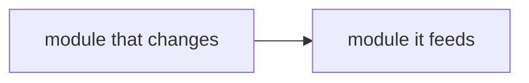
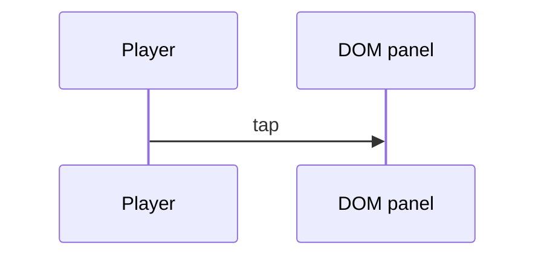

# Design — #<story> <story subject>

<!-- Copy to docs/design/<story#>-<slug>.md and list it in docs/INDEX.md.
     scripts/docs-index-check.mjs checks: a component diagram (flowchart, graph
     or classDiagram), a sequenceDiagram, a link to the architecture doc, and a
     test map row for every AC in the spec. -->

**Story:** #<story> · **Spec:** [docs/specs/<story#>-<slug>.md](../specs/<story#>-<slug>.md) · **Architecture:** [docs/plan/architecture/README.md#<section>](../plan/architecture/README.md)

## Components

Which modules change and which own each fact the player sees.

## Flow

## Data

State read and written (save fields, keys), and whether it survives a reload.

## Test map

<!-- C3: each AC maps to a test that fails on main before the change. -->

| AC | Test file | Test name | Fails on main because |
|---|---|---|---|
| AC-1 | `aftersign/e2e/<file>.spec.ts` | `<test name>` | … |
| AC-2 | `aftersign/src/<file>.test.ts` | `<test name>` | … |

## Risks

- …
